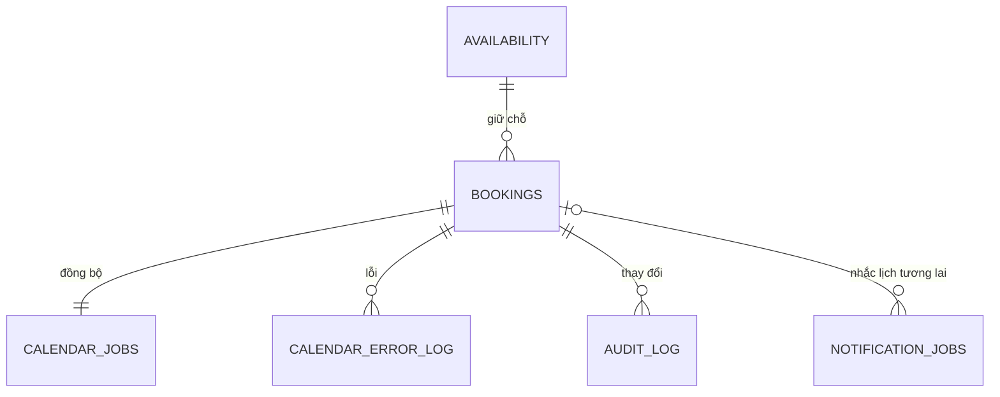

> Tài liệu thiết kế từ GĐ1. GĐ2 đã triển khai worker/API; xem `GD2-HUONG-DAN.md` cho trạng thái, cách gọi và cấu hình hiện tại.

# Thiết kế dữ liệu GĐ1

## Quan hệ chính

## Bảng công khai — cấu hình tiệm và số chỗ, không có thông tin khách

| Bảng trong `public` | Khóa | Dữ liệu |
|---|---|---|
| shop_settings | id=true, chỉ một dòng | Tên, địa chỉ, số tiệm, thông báo, múi giờ, các hằng số nghiệp vụ |
| weekly_hours | weekday 0–6 | Giờ mở/đóng, sức chứa mặc định; 0 là Chủ nhật |
| capacity_rules | local_time | Ngoại lệ lặp mỗi ngày, mẫu 12:00 = 1 người |
| closed_days | local_date | Ngày đóng cửa và thông báo công khai |
| slot_overrides | local_date + local_time | Sức chứa riêng cho một ngày/giờ, 0 để đóng slot |
| services | UUID | Giá và mô tả mẫu, cờ is_sample |
| availability | starts_at, unique ngày+giờ | capacity, reserved và remaining được tính tự động |

`availability` chỉ cho khách đọc trong khoảng hôm nay đến hôm nay+9. Dữ liệu quá khứ vẫn nằm trong DB để giữ khoá ngoại và lịch sử nhưng RLS không cho khách đọc. Frontend phải lọc giờ còn tương lai; SQL đặt lịch luôn từ chối giờ đã qua.

Thứ tự tính sức chứa: **ngày nghỉ/ngoài giờ/weekday capacity=0 → đóng**, sau đó **slot_overrides → capacity_rules → weekly_hours**. Slot override không thể mở lại giờ ngoài giờ làm hoặc ngày đang đóng; muốn mở phải sửa lịch làm việc/ngày nghỉ trước. Chỗ trống là số người, không phải số đơn.

## Bảng riêng tư

| Bảng trong `nail_private` | Nội dung và ràng buộc |
|---|---|
| owners | Auth user ID được phép quản trị; frontend không được sửa |
| bookings | Tên/phone, số người, thời gian, trạng thái, secret_hash, idempotency_key, fingerprint, event_id, version |
| blocked_phones | Phone chuẩn hoá, ghi chú chỉ chủ tiệm xem |
| calendar_jobs | 1 dòng/đơn; desired_version và processed_version; lease, attempts, thời điểm thử lại |
| calendar_error_log | Lỗi theo đơn/phiên bản; chỉ mã lỗi đã làm sạch, không chứa token/PII |
| audit_log | Tạo/dời/huỷ, thời gian cũ/mới, Auth ID của chủ tiệm nếu có |
| rate_buckets | Bộ đếm 15 phút theo loại thao tác + hash phone/IP; dọn sau 2 ngày |
| notification_jobs | Cấu trúc dự phòng cho SMS; không có worker hoặc lịch chạy ở GĐ1 |

`event_id` được tạo ngay lúc ghi đơn: tiền tố `dkn` + UUID bỏ dấu gạch. Chỉ chứa ký tự hợp lệ với event ID của Google Calendar. Đây là ID **đã cấp để dùng khi gọi Google**, không khẳng định event đã tạo. Trạng thái đồng bộ xác định bằng `processed_version = desired_version` và log worker.

Một phone chỉ có tối đa một đơn confirmed ở cùng thời điểm (`partial UNIQUE`). Một idempotency key chỉ có một đơn, secret_hash cũ được giữ nullable cho tương thích, không dùng để tra cứu/huỷ nữa. Version tăng khi dời/huỷ; `expected_version` giúp admin không ghi đè thay đổi từ tab khác.

## Transaction và tranh chỗ

1. API server lấy IP đáng tin cậy, tạo HMAC-SHA256 IP và chuyển vào RPC. SQL không nhận raw IP; không tin IP hoặc hash do trình duyệt tự gửi.
2. SQL tăng bộ đếm spam. Sai mã/slot hết vẫn tính lượt; phần đặt có savepoint riêng để rollback nghiệp vụ mà giữ bộ đếm.
3. Khoá advisory theo idempotency key, kiểm tra fingerprint. Replay khớp trả đơn cũ.
4. Khoá cấu hình dùng chung và khoá theo phone để kiểm tra giới hạn 3 lịch tương lai.
5. Trigger khoá slot bằng `FOR UPDATE`. Khi dời, khoá slot cũ/mới theo thời gian tăng dần.
6. Kiểm tra ngày/giờ, blacklist và số chỗ; cập nhật reserved và ghi đơn.
7. Trigger sau ghi đơn tạo/cập nhật calendar_jobs và audit_log. Tất cả commit hoặc rollback cùng nhau.

Khi hai request tranh chỗ cuối, request thứ hai chờ khoá slot, rồi thấy số reserved đã cập nhật. Không có bước frontend đọc remaining rồi tự quyết định việc ghi. `CHECK reserved<=capacity` chặn trạng thái vượt sức chứa; trigger giữ reserved bằng tổng people của đơn confirmed. Không cấp quyền ghi bảng trực tiếp cho khách hoặc admin, nên ứng dụng không có đường ghi né trigger.

Các thao tác admin đổi giờ/ngày nghỉ/capacity lấy khoá cấu hình độc quyền. Những thao tác đặt/huỷ/dời lấy khoá dùng chung; không thể có lần đặt đọc cấu hình nửa cũ nửa mới. `refresh_availability` chỉ cập nhật capacity khi thay đổi, tránh phát Realtime thừa.

DB owner/SQL Editor vẫn là quyền vận hành toàn hệ thống và có thể sửa bảng trực tiếp; đó không phải vai trò dùng trong frontend. Không phát tán thông tin đăng nhập database.

## Phân quyền

| Người gọi | Đọc số chỗ/cấu hình | Đọc dữ liệu khách | Ghi đơn | Quản trị |
|---|---|---|---|---|
| anon | Có, RLS giới hạn ngày availability | Không | Chỉ qua Edge ở GĐ2 | Không |
| authenticated không phải chủ | Có | 0 dòng qua RLS | Chỉ qua Edge ở GĐ2 | Không |
| authenticated là chủ | Có | Có qua RPC/admin RLS | RPC dời/huỷ | Có các RPC được cấp |
| service_role trong Edge | Qua RPC/cơ chế server | RPC tra cứu có phone+mã | RPC khách | Không tự gọi admin nếu không có JWT chủ |
| postgres trong SQL Editor | Toàn quyền vận hành | Toàn quyền | Toàn quyền | Dùng để cài đặt/khôi phục |

Schema riêng không được expose qua Data API. RLS vẫn bật như lớp bảo vệ bổ sung nếu cấu hình API vô tình đổi. `SECURITY DEFINER` dùng `search_path=''`, gọi bảng bằng tên schema đầy đủ; chỉ grant `EXECUTE` cho đúng nhóm. Các helper nội bộ không có quyền chạy công khai.

`service_role` là khoá máy chủ nhạy cảm có quyền rộng ở cấp nền tảng Supabase; bảng phân quyền mô tả những grant/RPC của ứng dụng này, không có nghĩa khoá bị lộ là an toàn. Không bao giờ nhúng khoá này vào frontend.

## Hợp đồng với worker Calendar ở GĐ2

- Worker nhận job có desired_version > processed_version, khoá hàng bằng `SKIP LOCKED`, cấp lease_token/leased_until và đọc snapshot đơn.
- Lệnh Google có timeout ngắn hơn lease; xử lý theo từng đơn, không chạy hai phiên bản chủ động cùng lúc.
- Tạo event bằng event_id cố định, tiêu đề `Họ tên - 0901234567 - 2 người`; khi gặp 409 thì đọc/đối soát ID đó, không tạo UUID khác.
- Dời cập nhật cùng event; huỷ xoá event. Nếu đơn huỷ trước khi từng tạo, worker có thể xác nhận vắng event rồi hoàn tất. 404/410 khi xoá là thành công về trạng thái mong muốn.
- Chỉ ACK đúng lease và phiên bản snapshot. Nếu đơn thay đổi trong lúc worker chạy, phiên bản mới còn pending và được xử lý tiếp.
- Lỗi giữ job, retry exponential backoff + jitter và ghi mã lỗi đã làm sạch. API đặt lịch trả sau commit DB, không đợi Google.
- Cần đối soát định kỳ vì không có transaction nguyên tử xuyên Postgres và Google. Timeout, worker chết hoặc quyền Google bị thu hồi có thể gây lệch tạm thời; không thể hứa Calendar luôn tức thì hoặc không lệch khi Google mất kết nối dài hạn.
- Chủ tiệm thao tác trên admin website. Sửa trực tiếp ở Google Calendar chưa đồng bộ ngược vào database; đối soát lấy database làm nguồn chính.
- Cron ngày mới gọi refresh_availability và maintenance_cleanup. GĐ1 gọi refresh lúc seed; từ ngày sau phải refresh thủ công cho tới khi GĐ2 cài cron.

## Chuẩn bị SMS sau này

`notification_jobs.kind` gồm `reminder_2h` và `owner_daily_19h`. `dedupe_key` chống gửi trùng. Reminder gắn booking_id + booking_version; daily digest có thể để booking_id null và dùng khóa theo ngày. Dời/huỷ đơn sẽ vô hiệu các reminder cũ chưa gửi. GĐ1 không tạo job gửi thật; không có nhà cung cấp SMS, API key, cước gửi hay scheduler hoạt động.
